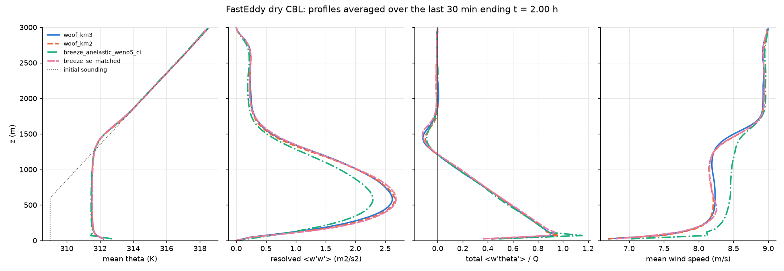
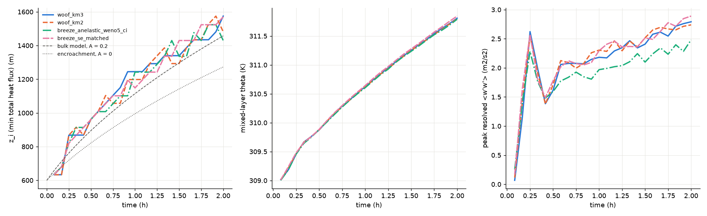
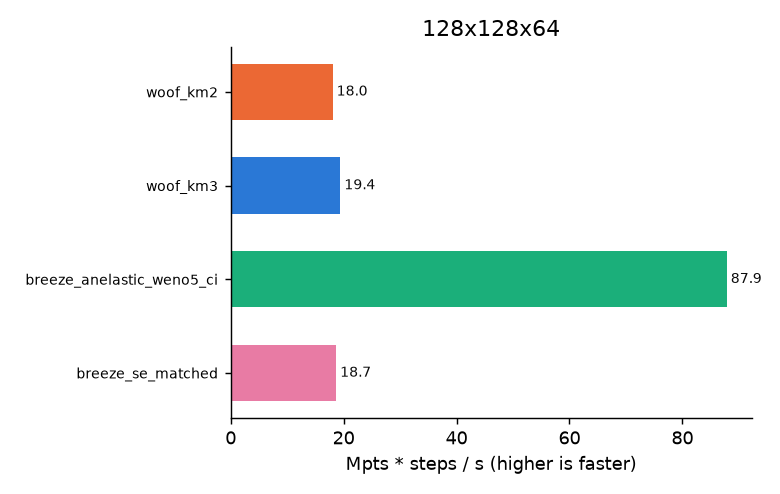

# woof vs Breeze.jl: the FastEddy dry-CBL LES benchmark

This page covers one unit of the Clima / NumericalEarth comparison. The question
is narrow: on one standard large-eddy simulation (LES) case, is
[Breeze.jl](https://github.com/NumericalEarth/Breeze.jl) faster than woof, more
accurate, or able to run fine-grid LES more cheaply? Breeze is NumericalEarth's
GPU atmosphere model on Oceananigans. The harness, with exact commands, is in
[tools/compare/breeze_cbl/](../../../tools/compare/breeze_cbl/README.md).

Every statement below is labelled with one of three tags:

- **documented**: taken from a source and cited.
- **measured**: produced by this harness. The output is committed under
  [les-benchmark/](les-benchmark/).
- **estimated**: arithmetic on the other two.

Every timing measured here so far comes from a **shared** RTX A6000. A Maui
hex forecast and several other test workers held about 33 GiB of the card and
competed for its SMs, and every run used a 6 GiB memory cap. Treat those
timings as a smoke test of the harness, not as a speed result. The full-size,
interleaved timing on an idle card is `tools/compare/breeze_cbl/run_timing.sh`,
which has not been run yet.

## Answer so far

| question | answer | basis |
|---|---|---|
| Do the two models agree on this case? | **Yes, closely.** At 94 m / 47 m spacing after 2 h, z_i from the heat-flux minimum falls between 1436 and 1490 m across four variants, a spread of about one Δz (47 m). Mixed-layer θ agrees within 0.05 K. Peak ⟨w′w′⟩ agrees within 3% when Breeze runs woof's operators. | measured |
| Is either closer to the reference? | **Neither, measurably.** All four variants sit within 2.3% of the zero-order-jump bulk model's z_i (1457 m with A = 0.2). The FastEddy reference figure is at 4 h, and the 4 h runs have not been made yet (`PROFILES=1`). | measured; theory |
| Where do they differ? | Breeze's default configuration, WENO5 with no explicit subgrid closure, gives **13% less peak ⟨w′w′⟩** (2.30 against 2.63–2.69 m²/s²) at this spacing. Its stock constant-u★ surface drag gives a 0.25 m/s faster mixed-layer wind. Both differences come from the configuration, not the dynamical core. With woof's operators, Breeze's compressible core reproduces woof's profiles. | measured |
| Is Breeze faster? | **Its anelastic core: very probably**, by 4.3–4.5× per step over woof in two passes on the shared card at 128²×64. That is roughly what follows from an anelastic step having no acoustic substeps. **Its compressible split-explicit core with woof's operators: about the same as woof.** It measured 1.39× woof in one pass and 0.96× in the other, so the shared card's noise exceeds the difference. Neither ratio should be quoted until `run_timing.sh` runs on a clean card at 256²×128 and 384²×192. | measured (shared card); documented |
| 50–100 m runs | Both run this case at 94 m and 47 m grid spacing. Measured live device memory per grid point is of the same order (about 150–245 B, depending on variant), so neither model is memory-bound for a 50 m box of this size. Throughput, not memory, decides the cost. | measured; estimated |

## 1. The case and how it is matched

The case is the convective boundary layer (CBL) of Sauer & Muñoz-Esparza (2020)
[doi:10.1029/2020MS002100](https://doi.org/10.1029/2020MS002100), §4.2 (documented):
SWiFT, 4 July 2012. Breeze runs this case in its daily CI benchmark
([BreezeBenchmarks](https://github.com/NumericalEarth/BreezeBenchmarks);
Breeze `benchmarking/src/convective_boundary_layer.jl` at tag v0.12.0, commit
`740c6938`). FastEddy ships it as `tutorials/examples/Example02_CBL.in`
(NCAR/FastEddy-model `e0cd2f3e`). `tools/compare/breeze_cbl/case.py` holds the
single definition of the parameters.

| | woof (`run_woof.py`) | Breeze (`run_breeze.jl`) | FastEddy tutorial |
|---|---|---|---|
| domain | 12 × 12 × 3 km, periodic, flat, rigid lid | same | 12 × 11.9 × 3 km, 400 m Rayleigh layer |
| grid | eta ladder built to be **uniform in z** (Δz = Lz/nz; the measured spread is under 0.001 m) | rectilinear z | 20 m, stretched vertical |
| initial θ | 309 K to 600 m, then +4 K/km; ±0.25 K uniform noise below 400 m | same | same |
| forcing | Ug = (9, 0) m/s, f = 8.05e-5 s⁻¹ | same | same |
| surface heat | 0.35 K m/s | same | same |
| surface momentum | bulk drag, Cd = (κ/ln(z₁/z₀))², z₀ = 0.05 m (WRF `isfflx=0`) | `_matched` variants use the same bulk Cd; `_ci` variants use Breeze's constant u★ = 0.4 m/s | Monin–Obukhov, z₀ = 0.05 m |
| Δt, precision | 0.5 s, Float32 | 0.5 s, Float32 | 0.05 s |

Two pieces were added or adjusted only in the harness, never in the engine:

- **Geostrophic forcing.** woof has no idealized geostrophic pressure-gradient
  option (WRF's `pert_coriolis` is not ported). `run_woof.py` runs woof's WRF
  Coriolis kernel on the full wind and adds (−f Vg, +f Ug)·Δt to the velocity
  once per step, operator-split. The balance holds: the wind at the top of the
  domain was 8.97 m/s and |v| was below 0.006 m/s after 2 h (measured).
- **Drag.** woof's LES lower boundary supports only the WRF constant-Cd form.
  The Breeze `_matched` variants therefore use the same law through a field-dependent
  `FluxBoundaryCondition`. The `_ci` variants keep Breeze's published
  configuration.

The cross-check `analyze.check_matched` reported no mismatch in dt, heat flux,
f, Ug, p_surf, precision or Cd across the runs.

## 2. What cannot be matched exactly: numerics and closures

| | woof | Breeze, `_ci` (published CI) | Breeze, `_matched` |
|---|---|---|---|
| equations | fully compressible, WRF ARW mass (hydrostatic-pressure) coordinate | anelastic: SSP-RK3 plus an FFT-tridiagonal Poisson solve per stage, no acoustics | compressible, Wicker–Skamarock RK3 with split-explicit acoustics |
| acoustic substeps | `time_step_sound = 12`, WRF distribution (1 + 6 + 12 = 19 per Δt), epssm 0.1, smdiv 0.1 | none (anelastic); the SE CI variant uses 12 proportional substeps (4 + 6 + 12 = 22), ω = 0.65 | 12, `MonolithicFirstStage` (1 + 6 + 12 = 19), ω = 0.55 (= epssm 0.1), thermal divergence damping 0.1 |
| advection | WRF upwind, 5th order horizontal and 3rd vertical, momentum and scalars | WENO5 in all directions | `FluxFormAdvection(UpwindBiased(5), UpwindBiased(5), UpwindBiased(3))` |
| SGS closure | `km_opt=3` 3-D Smagorinsky (c_s 0.18, Pr 1/3, N² correction, l = (ΔxΔyΔz)^⅓) or `km_opt=2` 1.5-order TKE (c_k 0.10) | none: implicit LES, where WENO's numerical dissipation stands in for the SGS model | Oceananigans Lilly–Smagorinsky with C = 0.18, Cb = 1/(2 Pr) = 1.5, Pr = 1/3. Oceananigans writes ν = (CΔ)² √(2Σ² − 2 Cb N²) with Σ² = SᵢⱼSᵢⱼ, so this is algebraically WRF's `sqrt(max(0, def2 − N²/Pr))` with def2 = 2SᵢⱼSᵢⱼ |

Sources (documented): woof `woof/core/kernels/smag2d.cu:2303`
(`sqrtf(fmaxf(0, def2 - bn2/prandtl))`) and `woof/core/advection.py`. Breeze
`src/CompressibleEquations/time_discretizations.jl` (substep distributions,
`forward_weight` ω with ε = 2ω − 1), `src/AnelasticEquations/anelastic_pressure_solver.jl`
and `src/AtmosphereModels/dynamics_interface.jl:81`. Oceananigans 0.113.6
`Smagorinskys/lilly_coefficient.jl:109`.

Not matchable:

- **woof `km_opt=2` has no Breeze counterpart.** Breeze 0.12's
  `TKEBasedTurbulenceClosure` is a vertical (PBL-type) formulation, not a 3-D
  LES subgrid TKE closure.
- **WENO5 versus upwind-5.** WENO5 is a nonlinearly weighted 5th-order upwind
  scheme. It falls back towards 3rd order near sharp gradients, so where the
  flow is not smooth it is more dissipative than WRF's linear 5th-order upwind
  stencil. The `_matched` variant swaps it out, which is what makes the
  comparison like-for-like.
- **The coordinate.** woof's mass coordinate lets layer heights breathe as
  the column warms. The analysis uses woof's instantaneous mean geopotential
  heights against Breeze's fixed z faces; the difference is a few metres.

## 3. Accuracy (measured, 128²×64 = 94 m × 47 m, 2 simulated hours)

Statistics are means over the last 30 minutes, with samples every 5 minutes.
z_i(flux) is the height of the minimum total heat flux (resolved plus explicit
SGS), the em_les / FastEddy definition. z_i(grad) is the height of the largest
mean dθ/dz. It does not depend on the closure, and it sits about 150 m higher
because it marks the top of the entrainment zone.

| run | z_i flux (m) | z_i grad (m) | θ_ml (K) | max ⟨w′w′⟩ (m²/s²) | at z (m) | min ⟨w′θ′⟩/Q | U_ml (m/s) |
|---|---|---|---|---|---|---|---|
| woof_km3 | 1441 | 1604 | 311.53 | 2.63 | 593 | −0.118 | 8.21 |
| woof_km2 | 1447 | 1584 | 311.52 | 2.66 | 580 | −0.098 | 8.18 |
| breeze_anelastic_weno5_ci | 1436 | 1614 | 311.51 | 2.30 | 569 | −0.088 | 8.46 |
| breeze_se_matched | 1490 | 1621 | 311.56 | 2.69 | 583 | −0.122 | 8.20 |
| bulk model, A = 0 / 0.2 (theory) | 1273 / 1457 | | | | | −0 / −0.2 | |





Reading the measurements:

- **The mean state is the same in all four runs.** The mixed-layer θ curves
  overlie each other for the whole 2 h. In every variant z_i(flux) runs
  0–100 m above the A = 0.2 zero-order-jump bulk model from 0.5 h onwards,
  and ends within 2.3% of it at 2 h.
  [`case.bulk_model_zi`](../../../tools/compare/breeze_cbl/case.py) gives the
  bulk model, h² = h₀² + 2(1 + 2A)Qt/γ. That is a theory reference, not a
  model run.
- **Turbulence intensity depends on the closure and advection choice, not on
  the dynamical core.** Breeze's compressible core with woof's operators gives
  a ⟨w′w′⟩ profile within 3% of woof's at every height. Breeze's published
  implicit-LES configuration gives 13% less at the peak. At 94 m spacing the
  CBL spans only about 15 cells, so WENO's added dissipation shows directly in
  the resolved variance. The FastEddy figure shows about 2.85 m²/s² at 4 h on a
  20 m grid, but z_i is deeper at 4 h, so it cannot yet rank the variants.
- **Entrainment flux ratios** fall between −0.09 and −0.12, short of the
  canonical −0.2. This is the expected bias at about 30 cells per z_i, and it
  is noisy: woof's own receipts show a ±40% frame-to-frame spread for this
  statistic ([LES.md §2](../../public/LES.md)). It cannot separate the models
  from a single 2 h draw each.
- **FastEddy reference (estimated).** These values were read by eye from the
  FastEddy tutorial figures (`docs/Tutorials/images/{MEAN,TURB}-PROF-convective.png`,
  4 h, 20 m grid): z_i(flux) ≈ 1800 m, θ_ml ≈ 312.3 K, peak ⟨w′w′⟩ ≈ 2.85
  m²/s² at about 800 m. The bulk model at 4 h gives 1972 m (A = 0.2). The
  paper's own WRF-LES comparison figure could not be retrieved (the publisher
  returned 403), so no WRF-LES numbers appear on this page. Matching the 4 h
  time needs `PROFILES=1 run_timing.sh` (256²×128 for 4 h). Until that runs,
  **no claim is made that either model is closer to FastEddy.**

The run is a single realisation per variant at one coarse resolution. The
z_i diagnostics are quantised to the grid (Δz = 47 m, sampled every 5
minutes), so the 54 m spread in z_i(flux) is about one grid level. The
entrainment ratio is too noisy to rank the models (see above). The 13%
⟨w′w′⟩ deficit of the implicit-LES run is the one difference that persists
through the whole second hour of the evolution plot. It is still a single
draw per variant: no ensemble has been run on either side.

## 4. Speed

### Documented

| source | card | case | figure |
|---|---|---|---|
| BreezeBenchmarks CI, anelastic, WENO5 | NVIDIA L4 | 512²×256, Float32 | 0.518 s/step, **129.6 Mpts·steps/s** |
| BreezeBenchmarks CI, compressible SE, WENO5, 12 substeps | NVIDIA L4 | 512²×256 | 2.38 s/step, **28.2 Mpts·steps/s** |
| woof LES.md §2 (km_opt 2 / 3, `time_step_sound=4`) | RTX 5090 | 192²×96, 28,800 steps, 858 s / 753 s | **119 / 135 Mpts·steps/s** (derived from the documented wall times) |

The woof and Breeze rows differ in card and grid. They also differ in acoustic
substeps: woof's documented rows use 7 acoustic substeps per Δt at Δt =
0.25 s, against 19–22 for the compressible runs here. These documented rows
are not a head-to-head comparison.

### Measured (shared card, 128²×64, Float32, Δt = 0.5 s, ns = 12)

Two passes of the same timing runs, an hour apart, on the shared card:

| run | pass 1 s/step | pass 2 s/step | pass 2 Mpts·steps/s | pass 2 simulated s / wall s | relative to woof_km3 (pass 1 / pass 2) |
|---|---|---|---|---|---|
| woof_km3 | 0.0783 | 0.0540 | 19.4 | 9.3 | 1.00 / 1.00 |
| woof_km2 | 0.0908 | 0.0581 | 18.0 | 8.6 | 0.86 / 0.93 |
| breeze_anelastic_weno5_ci | 0.0182 | 0.0119 | 87.9 | 41.9 | 4.30 / 4.52 |
| breeze_se_matched | 0.0564 | 0.0561 | 18.7 | 8.9 | 1.39 / 0.96 |

Pass 1 ran Breeze's Smagorinsky with Cb = 3, a matching error found in code
review. Pass 2 and every profile on this page use the corrected Cb = 1.5. The
reduction factor changes ν, not the operation count. The 30% swing in woof's
step time between passes, and the two timed blocks of
`breeze_se_matched` in pass 2 (0.070 s and 0.042 s), show how much the other
tenants move these numbers.



Each figure is the median of two timed blocks of 50 steps, taken after 10
warm-up steps. The warm-up absorbs Breeze's JIT compilation (70–90 s of model
build, then 5–28 s of first steps) and woof's NVRTC compilation (about 2 s).
On a 1-million-point grid with a contended card these figures **are not
performance claims**. A grid of this size is too small to load an A6000, so
per-step fixed costs and kernel-launch latency weigh heavily. A woof step at
64²×32 took 19 ms, a third to a quarter of the 128²×64 time for an eighth of
the points (measured).

What the measurements do support (estimated):

- **The anelastic speed-up is structural.** An anelastic step does three RK
  stages with one Poisson solve each. A split-explicit step adds 19–22
  acoustic substeps. For a dry LES at Δt = 0.5 s, where sound waves carry no
  physics, Breeze's anelastic core is the cheap option, and woof has no
  anelastic core. The ratio at full size should be measured, not assumed:
  Breeze's own CI shows anelastic 4.6× faster than SE on an L4, and this
  harness measured 3.1–4.7× between `breeze_anelastic_weno5_ci` and
  `breeze_se_matched` on the shared card. Those two runs also differ in
  advection and closure.
- **Compressible against compressible**, with the same substep count and
  distribution, the same advection and the same closure, the two models were
  within the shared card's noise of each other (Breeze 1.39× woof in pass 1,
  0.96× in pass 2). Whether either is faster on an idle card, with a grid
  that fills it, is exactly what `run_timing.sh` measures.

## 5. High-resolution (50–100 m) runs

Both models ran this case stably at Δx = 94 m and Δz = 47 m with Δt = 0.5 s.
The maximum |w| was 7.7–8.9 m/s, and no run produced a non-finite value
(measured). woof's own receipts take this closure family to 50 m and to
nz = 192 ([LES.md](../../public/LES.md) §2, §4; documented).

Device memory measured in timing mode at 1.05 M points:

| run | GiB | bytes / point | memory counter |
|---|---|---|---|
| woof_km3 | 0.178 | ≈ 182 | CuPy pool `used_bytes` (live arrays); the reservation is 0.182 GiB |
| woof_km2 | 0.237 | ≈ 243 | CuPy pool `used_bytes`; the reservation is 0.257 GiB |
| breeze_anelastic_weno5_ci | 0.143 | ≈ 147 | `CUDA.used_memory` |
| breeze_se_matched | 0.240 | ≈ 245 | `CUDA.used_memory` |

Both counters measure live bytes in each runtime's pool, so they are
comparable to within allocator overheads. A small grid inflates bytes per
point with fixed costs.

Estimated from that table:

- A 50 m version of this box (240² × 120 at Δz = 25 m, 6.9 M points) needs
  1–2 GiB in either model.
- A 48 GiB card holds roughly 200–350 M points. That is a 20 m grid over the
  full 12 × 12 × 3 km box (600² × 150 ≈ 54 M points) with room to spare.
  Breeze documents about 26 GB for 512³ (≈ 194 B/point).

At 50–100 m, cost is therefore set by Mpts·steps/s and by the time step. Both
models need Δt ≈ 0.25–0.5 s for advective CFL at these spacings, so the
anelastic-versus-compressible structure dominates the comparison.

The physics needed at 50–100 m differs between the two:

- woof carries both WRF LES closures, a prognostic SGS TKE and WRF's surface
  options. On a real case those connect to the full moist, terrain and
  radiation stack used by its nested 250 m LES children
  ([LES.md](../../public/LES.md) §2, documented).
- Breeze offers Smagorinsky-type closures, implicit LES, and a vertical TKE
  scheme. This unit did not exercise Breeze's moist, terrain or radiation
  options.

## 6. Reproduce

```bash
# small end-to-end (shared card; ~1.5 h including lock waits)
PY=python tools/compare/breeze_cbl/run_e2e_small.sh
# clean card: full sizes, interleaved, medians (+ 4 h profiles)
PY=python tools/compare/breeze_cbl/run_timing.sh
PY=python PROFILES=1 tools/compare/breeze_cbl/run_timing.sh
```

The Julia environment (Julia 1.12.7, Breeze 0.12.0, Oceananigans 0.113.6,
CUDA.jl 6.4.2, with the depot already precompiled) is at
`/home/jacob/wf-scratch/les-benchmark/`. The committed measurements are
[les-benchmark/summary.json](les-benchmark/summary.json) and
[summary.md](les-benchmark/summary.md).
